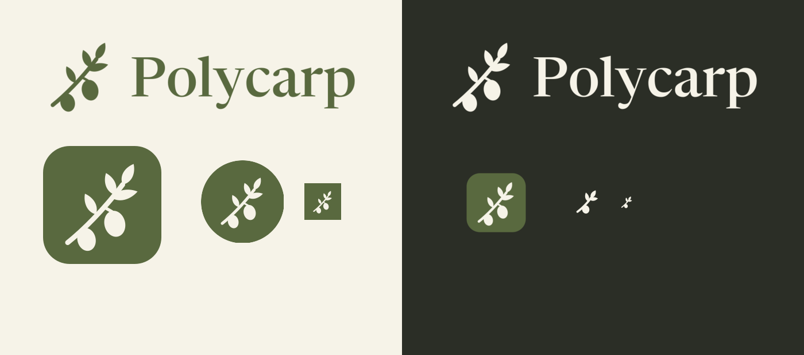

# Polycarp brand

## Why this name and mark

Polycarp means "much fruit." Polycarp of Smyrna was a disciple of the apostle John and died a martyr:
"Eighty and six years have I served him" (Martyrdom of Polycarp 9.3).

The mark is an olive branch. "I am like a green olive tree in the house of God. I trust in the steadfast
love of God forever and ever" (Psalm 52:8, ESV). What Scripture says God wants is fruit like "the peaceful
fruit of righteousness" (Hebrews 12:11, ESV), so the colors are meant to be calm.

Tagline: **Bear much fruit.** When a line must explain the product: **Speak it. Find it. Hand it off.**

## Files

| File | Use |
| --- | --- |
| `mark.svg` | Full branch. 32 px and up |
| `mark-small.svg` | Simpler branch for 16 to 24 px. Always use it in a menu bar or tray |
| `wordmark.svg`, `wordmark-on-dark.svg` | Branch plus the name, outlined from Newsreader |
| `icon-macos.svg` | Mac app icon, with the standard margin and corners |
| `icon-full-bleed.svg` | iOS, Windows, Linux and web. The system adds its own corners |
| `icon-android-foreground.svg` | Android adaptive icon foreground, on a `#59693F` background layer |
| `browser/icon.svg`, `browser/icon-16.svg` | The browser extension: the branch and a pointer, and the branch alone below 24 px |
| `export/` | PNG sets per platform, `windows/polycarp.ico`, and `tray/` black-on-transparent template images |
| `tools/` | The scripts that draw the marks and wordmark. `gen.py` takes an output folder |

## Color

| Role | Hex | Contrast |
| --- | --- | --- |
| Vine green, primary | `#59693F` | 5.37 with Cream |
| Still water, secondary | `#3F6B6A` | 5.37 with Cream |
| Old gold, working | `#856A29` | 4.62 on Cream |
| Ink, dark neutral | `#2B2E26` | 12.42 with Cream |
| Cream, light neutral | `#F6F3E8` | |
| On dark: Vine, Water, Gold | `#A9BB8A`, `#8EBDB9`, `#C7B07A` | 6.68, 6.66, 6.52 on Ink |

Red and amber appear only for errors and warnings.

## Type

Newsreader (SIL OFL) for headings, the wordmark and web text. Native apps use each platform's system font.

## Rules

- Clear space: one olive's height on every side. Minimum: 16 px small mark, 72 px wordmark.
- Don't stretch, recolor outside this palette, add effects, or set the name in all caps.
- Scripture and the saint's story belong on the about page and in the README, not in errors or buttons.
- Say what happens ("Polycarp typed it"), in short, plain sentences.
