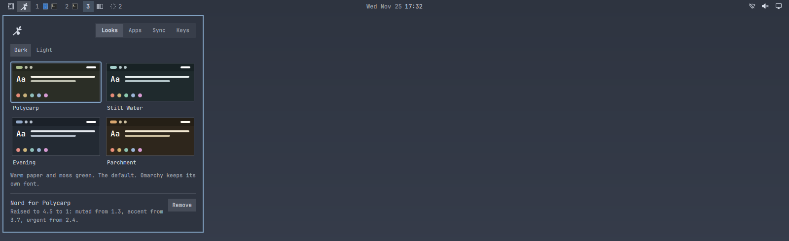

# Polycarp for Omarchy

Polycarp's parts for Omarchy 4's own shell. It wears the Omarchy theme you are using.



- **Workspaces.** Each monitor's workspaces with the icons of the apps on them. The one in use sits in a pill that slides. A dot marks a window that wants you. Click to go there, scroll to step, click the one in use to change its layout.
- **Agents.** How many coding agents are working and how many want you. Click for the list, and a click or Enter there goes to the window, and to the tmux or herdr pane.
- **Clock and tray.** Two more parts you can place: a two-tone clock with a calendar, and the tray in a drawer.
- **The panel.** A click on the mark, or a key. *Looks* turns a Polycarp theme into an Omarchy one and back, *Apps* sets your default browser, terminal, editor and coding agent, *Sync* says whether Polycarp Sync is set up, and *Keys* lists the keys.

## Needs

Omarchy 4.0.4 or newer. Everything it runs comes with Omarchy: `bash`, `hyprctl`, `omarchy`, and the usual `ps`, `find`, `awk` and `sed`. `tmux` and `herdr` are used when they are already running. Nothing is downloaded, nothing runs as root, and it makes no network requests.

## Install

```sh
omarchy plugin add https://github.com/baney75/omarchy-polycarp.git --enable
```

`omarchy plugin update baney75.polycarp` brings a newer one. It goes on the left of the bar, after Omarchy's own workspaces. Move it as you would any widget, by dragging it or with `omarchy bar move`. To keep only Polycarp's workspaces, take the `omarchy.workspaces` entry out of `bar.layout` in `~/.config/omarchy/shell.json`.

To open the panel from the keyboard, put this in `~/.config/hypr/bindings.lua`:

```lua
o.bind("SUPER + ALT + P", "Polycarp", "omarchy-shell shell toggle baney75.polycarp")
```

## Settings

Set them in `~/.config/omarchy/shell.json`, beside the widget's `id`:

| Setting | Values | What it does |
| --- | --- | --- |
| `show` | `all`, `mark`, `workspaces`, `agents`, `clock`, `tray` | Which part this place on the bar shows. `all` is the mark, the workspaces and the agents. `tray` steps aside while Omarchy's own tray is on the bar, so the bar has one. |
| `icons` | `true`, `false` | App icons on workspaces |
| `maxIcons` | 1 to 8 | Icons on one workspace before a count |
| `empty` | 0 to 10 | Empty workspaces shown |
| `labels` | `numbers`, `names` | What a workspace is called |
| `layout` | `true`, `false` | The layout of the workspace in use |
| `clock` | `auto`, `12`, `24` | `auto` follows your region |
| `day` | `true`, `false` | The day before the time |

To have the clock and the tray too, and take Omarchy's own off the bar:

```json
"left": [{ "id": "omarchy.menu" }, { "id": "baney75.polycarp" }],
"center": [{ "id": "baney75.polycarp", "show": "clock" }],
"right": [{ "id": "baney75.polycarp", "show": "tray" }, { "id": "omarchy.audio" }]
```

## Themes

Choosing a look writes an ordinary Omarchy theme to `~/.config/omarchy/themes/polycarp-<name>` and runs `omarchy theme set`. Z in the panel goes back to the theme and background before it, and takes away the folder it made. Saving the Omarchy theme in use writes `omarchy-<name>.toml` in Polycarp's themes folder.

Every look is measured. If small text would read under 4.5 to 1, the page says which colors, and by how much. Colors that are raised to reach it are named with the value they had.

It never replaces or removes a theme it did not write, or one you changed since: it says so and leaves it alone.

## What it reads and writes

| Where | What |
| --- | --- |
| Running processes, and their folders | To find coding agents. Their settings, accounts and files are not read. |
| Window titles | To tell whether an agent is working. They are not stored. |
| `~/.config/omarchy/themes/polycarp*` | Looks you choose |
| `~/.config/polycarp/themes/omarchy-*` | Omarchy themes you save |
| `~/.local/state/polycarp-omarchy/` | Checksums of what it wrote, and the theme to go back to |

At rest it runs no timers. It looks again when a window opens, closes, changes its title or takes the focus.

## Remove

```sh
omarchy plugin remove baney75.polycarp
```

That takes the plugin and its places on the bar. The themes it wrote stay, because one may be in use. To take those too, choose another theme first, then:

```sh
rm -r ~/.config/omarchy/themes/polycarp* ~/.local/state/polycarp-omarchy
```

The first of those also matches themes of your own whose names start with `polycarp`, so look before you run it.

## Work on it

The source is `plugins/omarchy` in [baney75/polycarp](https://github.com/baney75/polycarp); this repo is a copy that `plugins/publish-omarchy.sh` there writes. Run the tests with Node 20.12 or newer:

```sh
node --test test/*.test.mjs
```

## License

MIT, in [LICENSE](LICENSE). The Polycarp name and mark are not covered by it.
